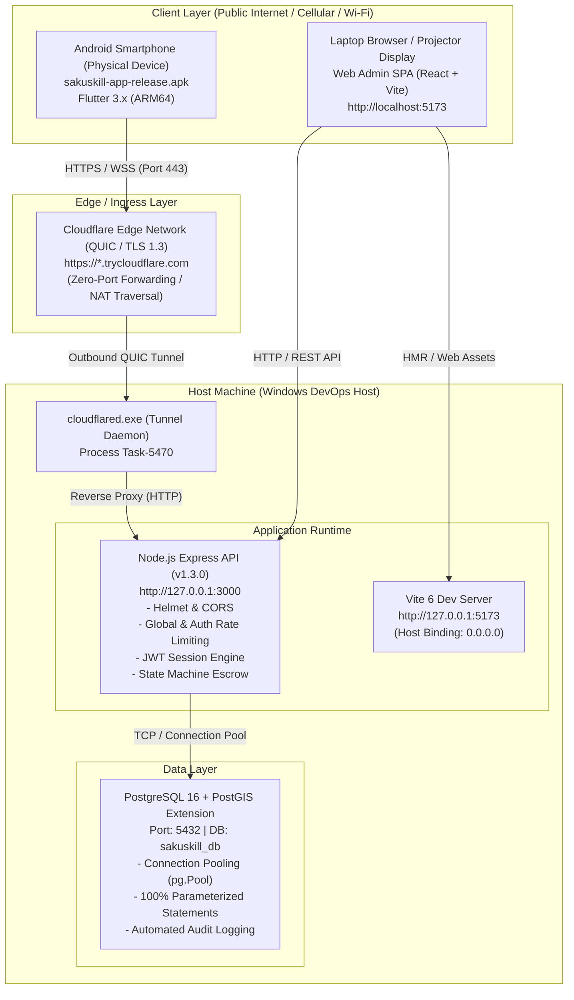

# 🛠️ Panduan Operasional DevOps & Deployment Multi-Device (Laptop & HP)
### Platform SakuSkill — Marketplace Jasa Mikro & Escrow Mahasiswa Kampus

> [!NOTE]
> Dokumen ini disusun khusus dengan perspektif **DevOps Engineer & Site Reliability Engineer (SRE)** berstandar industri. Memuat arsitektur sistem, topologi jaringan hybrid, manajemen dependensi, konfigurasi environment, serta panduan pengoperasian di laptop (server host) dan smartphone fisik (client node).

---

## 1. Arsitektur Sistem & Topologi Jaringan



---

## 2. Matriks Komponen & Port Binding

| Layanan | Host / IP Binding | Port Internal | Port Eksternal / URL Akses | Protokol | Healthcheck Endpoint |
| :--- | :--- | :--- | :--- | :--- | :--- |
| **PostgreSQL + PostGIS** | `127.0.0.1` | `5432` | N/A (Internal only) | TCP | `SELECT 1;` |
| **Backend REST API** | `0.0.0.0` | `3000` | Tunnel: Port 443 | HTTP/1.1 / JSON | `GET /api/v1/health` |
| **Web Admin Panel** | `0.0.0.0` | `5173` | `http://localhost:5173` | HTTP / HTML5 | `GET /` |
| **Cloudflare Tunnel** | `127.0.0.1` | Dinamis | `https://*.trycloudflare.com` | QUIC / TLSv1.3 | HTTP 200 via Cloudflare |
| **Mobile Client (APK)** | Dynamic IP (HP) | Client | Outbound HTTPS | TLSv1.3 | Ping via API Health |

---

## 3. Tata Kelola Konfigurasi & Variabel Lingkungan (`.env`)

Konfigurasi backend diisolasi pada `backend/.env` (berpedoman pada *The Twelve-Factor App: Config*):

```ini
# Environment Runtime
NODE_ENV=development
PORT=3000
API_PREFIX=/api/v1

# PostgreSQL Database Configuration
DB_HOST=localhost
DB_PORT=5432
DB_NAME=sakuskill_db
DB_USER=postgres
DB_PASSWORD=your_db_password

# JWT Authentication Engine
JWT_SECRET=super_secret_jwt_encryption_key_min_32_characters
JWT_EXPIRES_IN=7d

# Hyperlocal Geo-Fencing Configuration (UPI Cibiru Default)
DEFAULT_CAMPUS_LAT=-6.9311
DEFAULT_CAMPUS_LNG=107.7175
DEFAULT_HYPERLOCAL_RADIUS_METERS=3000
```

> [!IMPORTANT]
> Jangan pernah meng-commit file `.env` produksi ke VCS. Gunakan `backend/.env.example` sebagai template rujukan untuk rekan tim DevOps.

---

## 4. Runbook Pengoperasian di Laptop (Host Machine)

### A. Siklus Bersih Database (*Clean-Slate Seeding*)
Untuk mempersiapkan demonstrasi bersih tanpa data transaksi residu:
```powershell
# Direktori: backend/
cd "D:\Rizkia\Project Software\sakuskill\backend"
npm run db:clean
```
*Tindakan:* Mengosongkan 10 tabel transaksi secara kaskade (`CASCADE`), membersihkan user dummy, serta memastikan eksistensi akun Super Admin (`admin@sakuskill.ac.id` / `rahasia123`) dan master kategori keterampilan.

### B. Menjalankan Backend API Engine
```powershell
npm run dev
# Atau untuk mode produksi:
npm run start
```
*Indikator Sukses:* Muncul log `[SERVER] SakuSkill Backend API berjalan pada port 3000`.

### C. Mengaktifkan Cloudflare Ingress Tunnel
```powershell
& "C:\Users\majan\.gemini\antigravity\cloudflared.exe" tunnel --url http://localhost:3000
```
*Output penting:* Salin URL `https://<subdomain>.trycloudflare.com` yang dihasilkan. URL ini dapat diakses secara publik tanpa batasan firewall lokal atau konfigurasi port forwarding router.

### D. Menjalankan Web Admin Panel (Vite)
```powershell
# Direktori: admin/
cd "D:\Rizkia\Project Software\sakuskill\admin"
npm run dev -- --host
```
*Akses:* Buka `http://localhost:5173` pada browser presenter/proyektor.

---

## 5. Runbook Pengoperasian di Smartphone (Mobile Client)

### A. Distribusi & Pemasangan APK Rilis
File rilis APK telah dioptimasi dengan arsitektur ARM64 dan *tree-shaking* aset:
* **Lokasi Artefak:** `D:\Rizkia\Project Software\sakuskill\sakuskill-app-release.apk`
* **Ukuran:** ~18.3 MB (Ringan dan responsif)
* **Instalasi Cepat via ADB (Opsional bagi DevOps):**
  ```powershell
  # Aktifkan USB Debugging di HP, hubungkan via kabel:
  adb devices
  adb install -r "D:\Rizkia\Project Software\sakuskill\sakuskill-app-release.apk"
  ```
  *Atau:* Kirimkan APK via kabel USB, Google Drive, WhatsApp Document, lalu tap pasang (*Install*).

### B. Konektivitas & Pengujian Jaringan
1. Smartphone **tidak wajib** berada pada satu jaringan Wi-Fi dengan laptop.
2. Aktifkan koneksi data seluler (Telkomsel/Indosat/XL) di smartphone.
3. Buka aplikasi **SakuSkill**.
4. Aplikasi akan otomatis mengarahkan seluruh permintaan jaringan ke URL Cloudflare Tunnel bawaan.

### C. Hidden Gesture (Konfigurasi URL Darurat di HP)
Jika URL Cloudflare Tunnel berubah atau saat demo ingin dialihkan ke IP LAN lokal:
1. Masuk ke halaman **Profil** di aplikasi mobile.
2. Gulir ke bawah hingga teks footer: `SakuSkill v1.0.0 · Platform Escrow Mahasiswa Kampus`.
3. Lakukan **Long-press (tekan tahan) selama 2 detik**.
4. Masukkan URL baru pada modal `Pengaturan Server API` (contoh: `https://subdomain-baru.trycloudflare.com/api/v1` atau `http://192.168.1.10:3000/api/v1`), lalu klik **Simpan & Sambungkan**.

---

## 6. Prosedur Git Version Control & Deployment Branching

Struktur percabangan repositori dirancang mengikuti pola **GitFlow**:
* `main` : Kode stabil rilis produksi.
* `develop` : Integrasi fitur berjalan dari seluruh tim pengembang.
* `release/v1.0.0-mvp` : Branch terisolasi untuk demonstrasi MVP, pengujian integrasi bersih (*clean-slate*), dan security hardening.

### Perintah Push ke GitHub Remote:
Jika Anda ingin mengirimkan branch ini ke remote GitHub Anda:
```powershell
cd "D:\Rizkia\Project Software\sakuskill"
git push -u origin release/v1.0.0-mvp
```
> [!TIP]
> Karena terminal IDE menjalankan subshell non-interaktif, jalankan perintah di atas langsung pada terminal PowerShell / VS Code interaktif Anda agar *Git Credential Manager* dapat menampilkan dialog autentikasi browser dalam satu klik.
