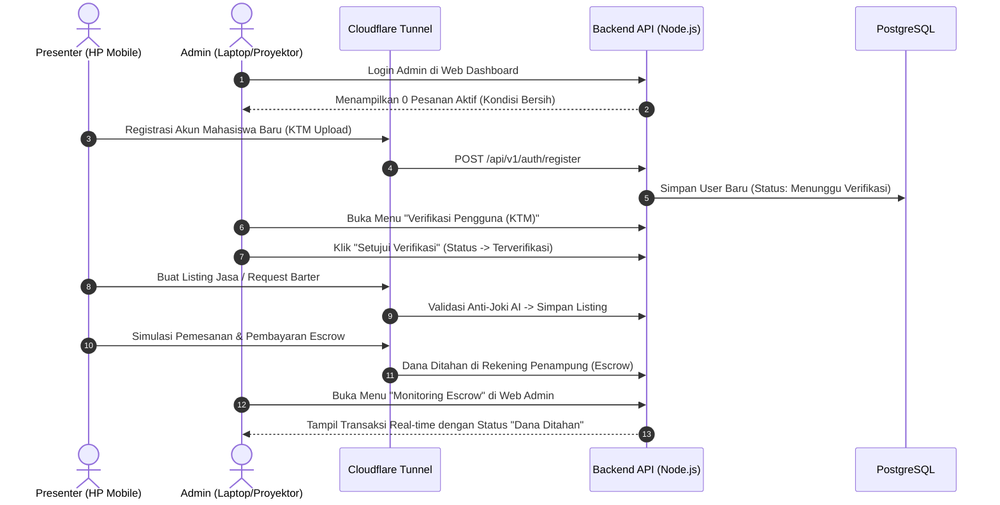

# 🚀 Panduan Eksekusi Demo & Presentasi SakuSkill (Live Network)

Dokumen ini memuat panduan lengkap untuk mempersiapkan dan menjalankan demonstrasi langsung (**live demo**) sistem **SakuSkill** pada saat presentasi, baik di hadapan dosen penguji, investor, maupun tim pengembang.

Sistem dirancang agar **Mobile App di smartphone fisik** dapat berkomunikasi secara *real-time* dengan **Backend API dan Web Admin di laptop presenter** tanpa batas jaringan (dapat menggunakan kuota seluler 4G/5G, Wi-Fi kampus, atau hotspot).

---

## 🌟 Ringkasan Konfigurasi Rilis (`release/v1.0.0-mvp`)

| Komponen | Status & Konfigurasi |
| :--- | :--- |
| **Git Branch** | `release/v1.0.0-mvp` (Lokal, terisolasi dari branch tim) |
| **URL Tunnel Publik** | `https://self-consult-allowed-marijuana.trycloudflare.com/api/v1` (Cloudflare Tunnel) |
| **Mobile App (APK)** | Bersih dari form hardcoded, icon setting jaringan dihilangkan (tampilan produksi 100%) |
| **Hidden Gesture** | Tekan tahan (*long press*) 2 detik pada teks versi footer di halaman **Profil** jika darurat ingin mengganti URL API |
| **Database Clean Script** | `npm run db:clean` (Mengosongkan semua transaksi & data uji coba, menyisakan Super Admin & Kategori) |
| **Web Admin Panel** | `http://localhost:5173` (Vite SPA) dengan modul Escrow, KYC KTM, Anti-Joki, dan Dispute |

---

## 🛠️ Langkah Persiapan Sebelum Presentasi

### 1. Jalankan PostgreSQL
Pastikan layanan PostgreSQL aktif pada port `5432` dengan database `sakuskill_db`.

### 2. Reset Database ke Kondisi Bersih (*Clean Slate*)
Buka terminal PowerShell di folder `backend`:
```powershell
cd "D:\Rizkia\Project Software\sakuskill\backend"
npm run db:clean
```
> [!NOTE]
> Perintah ini akan mengosongkan tabel transaksi, pesanan, pesan, laporan, dan user dummy, namun **mempertahankan akun Super Admin** (`admin@sakuskill.ac.id` / `rahasia123`) serta master kategori keterampilan.

### 3. Jalankan Backend API
Di terminal `backend`:
```powershell
npm run dev
```
Backend akan berjalan di port `http://localhost:3000`.

### 4. Aktifkan Cloudflare Tunnel
Buka terminal baru untuk mempublikasikan port 3000 ke internet:
```powershell
& "C:\Users\majan\.gemini\antigravity\cloudflared.exe" tunnel --url http://localhost:3000
```
> [!TIP]
> Cloudflare Tunnel bersifat gratis, tanpa batasan waktu 1 jam (berbeda dengan ngrok), tidak memerlukan akun, dan memberikan koneksi HTTPS terenkripsi berkecepatan tinggi.

### 5. Jalankan Web Admin Panel
Buka terminal di folder `admin`:
```powershell
cd "D:\Rizkia\Project Software\sakuskill\admin"
npm run dev -- --host
```
Buka browser di laptop/proyektor: `http://localhost:5173`.

### 6. Pasang Mobile APK di Smartphone
File APK rilis terbaru telah di-*build* dengan target ARM64 dan langsung terhubung ke Cloudflare Tunnel:
- File: `D:\Rizkia\Project Software\sakuskill\sakuskill-app-release.apk`
- Kirim/pindahkan ke HP via USB, WhatsApp, Google Drive, atau browser, lalu instal di HP.

---

## 🎬 Skenario Demonstrasi Interaktif (Alur Presentasi)

Berikut adalah urutan skenario demo yang memukau dan membuktikan integrasi end-to-end:



### Babak 1: Tampilkan Web Admin Bersih di Proyektor
1. Tunjukkan layar **Web Admin Dashboard** di proyektor laptop.
2. Sorot metrik: Total pengguna, transaksi, dan escrow berada di posisi awal (0 transaksi aktif).
3. Jelaskan bahwa sistem siap menerima interaksi langsung dari smartphone.

### Babak 2: Registrasi Akun Mahasiswa Baru di HP (Real Network)
1. Buka aplikasi **SakuSkill** di HP yang menggunakan kuota seluler (tanpa Wi-Fi laptop).
2. Klik **Daftar Akun Baru**:
   - Masukkan Nama, Email Mahasiswa (misal: `budi@mahasiswa.upi.edu`), Password, dan No. WhatsApp.
   - Perhatikan: Tidak ada opsi pemilihan peran (karena mahasiswa otomatis memiliki peran ganda fleksibel: pencari & penyedia).
3. Setelah berhasil mendaftar, beralih ke layar proyektor:
   - Di Web Admin menu **Pengguna**, klik *Refresh*.
   - Akun Budi langsung muncul secara instan!
   - Buka modal verifikasi KTM dan klik **Setujui Verifikasi**.

### Babak 3: Eksplorasi Fitur & Smart Barter di Mobile
1. Di HP, masuk ke menu **Jelajah** dan **Kategori**:
   - Tunjukkan responsivitas antarmuka (animasi mulus 60-120Hz).
   - Tunjukkan filter **Smart Barter** (pertukaran keterampilan non-tunai) dan filter Jasa Berbayar.
2. Tunjukkan opsi **Posting Jasa / Permintaan**:
   - Sistem dilengkapi perlindungan etika akademik (deteksi otomatis kata kunci joki tugas/skripsi ilegal).

### Babak 4: Monitoring Transaksi & Escrow di Web Admin
1. Lakukan simulasi pemesanan layanan di HP.
2. Di Web Admin, klik menu **Monitoring Escrow**:
   - Tunjukkan bahwa uang transaksi ditahan secara aman di sistem (*escrow holding*).
   - Dana tidak langsung diteruskan ke penyedia sebelum pekerjaan disetujui pemesan.
3. Buka menu **Pusat Sengketa (Dispute)**:
   - Tunjukkan fitur mediasi admin jika ada laporan mahasiswa atau kendala pengerjaan tugas.

---

## 🔒 Fitur Darurat: Pengaturan Alamat Server di HP

Untuk menjaga kerapian tampilan saat demo, seluruh icon pengaturan jaringan pada halaman Login, Registrasi, dan Profil telah **dihilangkan**.

Jika di tengah presentasi laptop berganti IP atau URL tunnel berubah:
1. Masuk ke halaman **Profil** di Mobile App.
2. Gulir ke bagian paling bawah hingga menemukan teks:
   `SakuSkill v1.0.0 · Platform Escrow Mahasiswa Kampus`
3. **Tekan dan tahan (long-press) teks tersebut selama 2 detik**.
4. Dialog rahasia **Pengaturan Server API** akan muncul.
5. Masukkan URL baru lalu klik **Simpan & Sambungkan**.

---

## ❓ FAQ & Troubleshooting

- **Q: Apakah Cloudflare Tunnel akan putus jika laptop ditutup atau sleep?**  
  *A:* Ya, pastikan laptop tetap menyala dan jendela terminal Cloudflare Tunnel tetap aktif selama sesi demo.
- **Q: Bagaimana jika internet kampus memblokir port tertentu?**  
  *A:* Cloudflare Tunnel menggunakan protokol HTTPS standar (Port 443) dengan QUIC, sehingga dapat menembus firewall kampus tanpa kendala.
- **Q: Mengapa branch `release/v1.0.0-mvp` tidak di-push ke GitHub remote?**  
  *A:* Sesuai arahan agar tidak mengganggu pekerjaan anggota tim lain yang sedang mengembangkan fitur di branch `develop`. Branch ini tetap aman tersimpan di repositori lokal laptop Anda.
