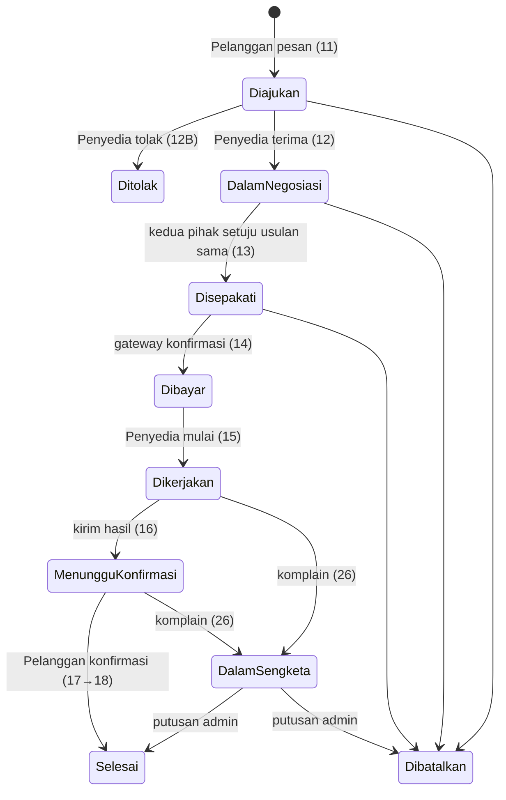
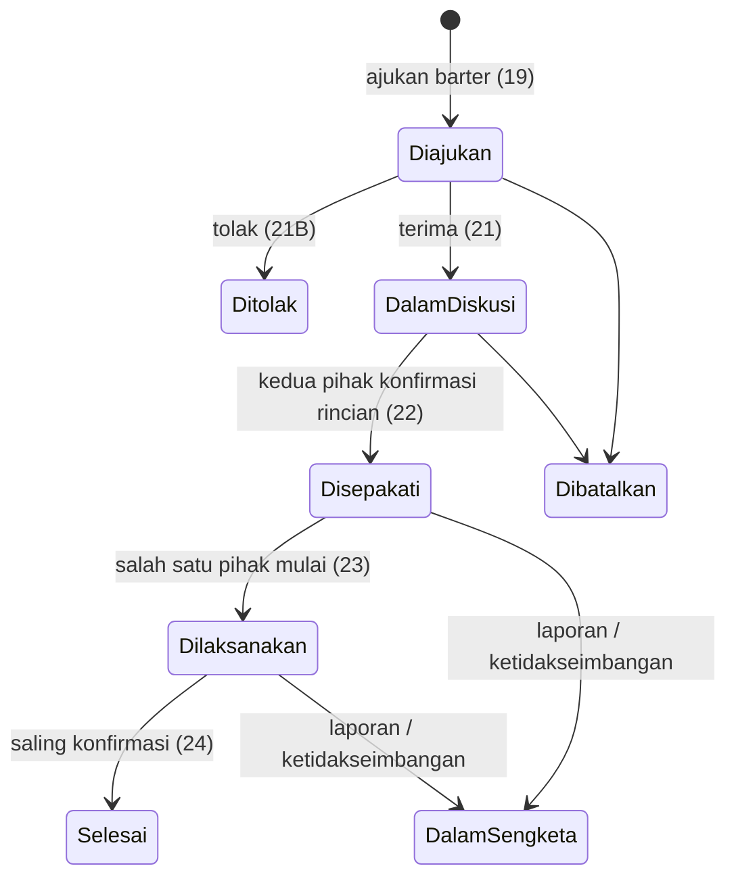

# PRD — SakuSkill Mobile (Frontend)

> Product Requirements Document dari sudut pandang **Frontend Engineering** (Flutter).
> Platform marketplace jasa mikro hyperlocal dan Smart Barter antar-mahasiswa serta warga sekitar kampus UIN SGD Bandung (Cibiru).

| Atribut | Nilai |
| :--- | :--- |
| Versi | 0.1 (draf awal) |
| Tanggal | 16 November 2026 |
| Penyusun | Tim Frontend (Anggota 3, Frontend Lead) |
| Status | Draf, menunggu tinjauan PM (Anggota 1) dan UI/UX (Anggota 2) |
| Acuan utama | SKPL SakuSkill Revisi 1.1 (11-11-2026), Jobdesk Tim SakuSkill, Figma `SakuSkill` (halaman *User Design*, *Desktop Design*, *page 3*), repo `luminariadev/sakuskill` branch `feat/fe-discovery` |
| Dokumen terkait | [`API_CONTRACT.md`](./API_CONTRACT.md), [`ERD_RINGKAS.md`](./ERD_RINGKAS.md), [`FRONTEND_DISCOVERY.md`](./FRONTEND_DISCOVERY.md), [`qa/TEST_PLAN.md`](./qa/TEST_PLAN.md) |

**Hierarki kebenaran.** Jika dokumen saling bertentangan, urutan yang berlaku adalah **SKPL 1.1 → keputusan PM tertulis → PRD ini → Figma → kode**. Konflik yang ditemukan dicatat pada §11 dan harus diputuskan PM sebelum modul terkait dirilis.

---

## 1. Ringkasan

SakuSkill mempertemukan mahasiswa yang punya keahlian praktis (desain, jasa teknis, fotografi, bimbingan belajar) dengan pelanggan dalam radius sekitar 2–3 km dari kampus. Ada dua jalur transaksi:

1. **Jasa berbayar**: pemesanan, negosiasi, pembayaran lewat payment gateway, dan *simulated escrow* (hanya mencatat status dana; sistem tidak menahan uang).
2. **Smart Barter**: tukar jasa tanpa uang dengan kesepakatan bilateral, pelaksanaan dua sisi, dan konfirmasi dua arah.

Kepercayaan dibangun lewat verifikasi akun, ulasan dan reputasi, serta pelaporan dan mediasi oleh Administrator.

PRD ini menerjemahkan SKPL menjadi kebutuhan yang bisa dikerjakan tim frontend, memetakan setiap kebutuhan ke layar Figma dan status kode saat ini, lalu menetapkan urutan kerja sampai MVP.

---

## 2. Latar belakang dan masalah

| Masalah | Dampak | Jawaban SakuSkill |
| :--- | :--- | :--- |
| Promosi jasa mahasiswa tersebar di grup chat dan media sosial | Pelanggan sulit membandingkan harga dan portofolio | Katalog terpusat dan Hyperlocal Service Board (daftar + peta) |
| Pencarian penyedia bergantung pada rekomendasi mulut ke mulut | Penyedia terdekat tidak ditemukan | Pencarian berbasis jarak (PostGIS + Haversine di klien) |
| Platform freelance global: persaingan tinggi, komisi besar | Mahasiswa sulit mendapat klien pertama | Fokus lokal, tarif ramah mahasiswa |
| Tidak ada mekanisme transaksi yang terstruktur | Perselisihan sulit diselesaikan | Status pesanan baku, audit log, laporan dan sengketa |
| Sebagian pengguna terbatas anggaran | Kebutuhan jasa tidak terpenuhi | Smart Barter (tukar keahlian) |

---

## 3. Tujuan dan metrik keberhasilan

### 3.1 Tujuan produk (MVP)
- **G1.** Pelanggan menemukan jasa relevan di sekitar kampus dalam waktu kurang dari 1 menit sejak membuka aplikasi.
- **G2.** Satu siklus transaksi jasa berbayar bisa diselesaikan end-to-end di aplikasi (Diajukan → Selesai → Ulasan).
- **G3.** Satu siklus barter bisa diselesaikan end-to-end dengan persetujuan bilateral.
- **G4.** Pengguna selalu tahu status transaksinya, dengan label status yang sama di semua layar (NFR-22).

### 3.2 Tujuan frontend
- **F1.** Seluruh layar *User Design* Figma terimplementasi dan terhubung ke data nyata (bukan `DemoData`).
- **F2.** Clean Architecture per fitur (`presentation → domain ← data`) dipertahankan di semua modul.
- **F3.** `flutter analyze` bersih dan `flutter test` hijau di CI setiap Pull Request.

### 3.3 Metrik (diusulkan, target final menunggu OD-28 dan OD-33)
| Metrik | Target usulan | Cara ukur |
| :--- | :--- | :--- |
| Waktu sampai feed Beranda tampil (cold start, jaringan 4G) | ≤ 3 detik | Profiling `flutter run --profile` |
| Tingkat penyelesaian tugas UAT (cari → pesan → bayar → konfirmasi) | ≥ 80% responden tanpa bantuan | UAT 10–15 responden (NFR-25) |
| Crash-free session saat UAT | ≥ 99% | Log klien |
| Cakupan tes logika inti FE (transisi status, filter, formatter) | ≥ 70% baris | `flutter test --coverage` |
| Temuan `flutter analyze` | 0 | CI |

---

## 4. Pengguna dan peran

| Aktor | Kebutuhan utama di aplikasi | Platform |
| :--- | :--- | :--- |
| **Penyedia Jasa** (mahasiswa) | Profil, portofolio, listing, menerima/menolak pesanan, ruang pengerjaan, kirim hasil, barter | Mobile |
| **Pelanggan** (mahasiswa atau warga) | Cari jasa, pesan, negosiasi, bayar, periksa hasil, ulasan, komplain | Mobile |
| **Administrator** | Verifikasi akun, moderasi listing/ulasan, tangani laporan dan sengketa, pantau transaksi | Web (Figma *Desktop Design*) |
| **Payment Gateway** (sistem eksternal) | Tidak berinteraksi langsung dengan FE; FE hanya membuka halaman bayar dan membaca status dari backend | — |

Catatan peran: Figma memakai satu akun yang berperan ganda (Beranda menampilkan "Jasa saya" dan pesanan sebagai klien sekaligus; *page 3* memuat "Profil dual-mode"). SKPL belum memutuskan ini (**OD-14**). FE mengasumsikan **satu akun bisa berperan ganda**, dan peran per transaksi ditentukan oleh posisi pengguna pada pesanan/barter tersebut. Asumsi ini perlu dikonfirmasi PM.

---

## 5. Lingkup

### 5.1 Termasuk MVP (SKPL Tabel 1.1)
| # | Modul | FR | Pemilik FE |
| :--- | :--- | :--- | :--- |
| 1 | Registrasi, autentikasi, profil | FR-01–10 | Anggota 3 (UI) + Anggota 5 (data/auth) |
| 2 | Profil dan portofolio penyedia | FR-11–16 | Anggota 3 |
| 3 | Hyperlocal Service Board (2–3 km) | FR-24–27 | Anggota 3 |
| 4 | Listing jasa | FR-17–23 | Anggota 3 |
| 5 | Pencarian dan penemuan | FR-28–32 | Anggota 3 |
| 6 | Pemesanan dan negosiasi | FR-33–42 | Anggota 4 |
| 7 | Komunikasi | FR-43–48 | Anggota 4 (konteks pesanan/barter) |
| 8 | Siklus transaksi | FR-49–50, 60–66 | Anggota 4 |
| 9 | Simulated escrow | FR-58–59 | Anggota 4 |
| 10 | Pembayaran nyata (payment gateway) | FR-51–57 | Anggota 4 + Anggota 5 |
| 11 | Barter Skill | FR-67–82 | Anggota 4 |
| 12 | Ulasan dan reputasi | FR-83–87 | Anggota 4 (form) + Anggota 3 (tampilan profil) |
| 13 | Moderasi dan pelaporan | FR-88–95 | Anggota 4 (laporan pengguna); dasbor admin lihat §5.3 |

### 5.2 Di luar MVP
- **AI Price Estimator**: SKPL §3.6.2 mengeluarkannya dari MVP, tetapi Jobdesk menugaskan Anggota 6 membangunnya (Groq + fallback lokal). Rute `AppRoutes.priceEstimator` sudah dicadangkan sebagai placeholder. Lihat konflik K-03.
- **Guardrail Anti-Joki dan URL Sanitizer** (Jobdesk Anggota 6): tidak ada di SKPL. FE menyediakan titik integrasi (validasi pada form listing/pesanan dan form kirim hasil kerja), tetapi aturan deteksinya milik Anggota 6.
- Escrow nyata, penahanan dana oleh platform, penarikan saldo (lihat K-01).
- Notifikasi push (saluran belum ditetapkan, OD-21). MVP memakai notifikasi dalam aplikasi.

### 5.3 Perlu keputusan
- **Dasbor Administrator web** (Figma *Desktop Design*: Login admin, Dasbor operasional, Manajemen pengguna, Manajemen layanan, Manajemen laporan, Sidang mediasi & putusan, Monitoring escrow). SKPL mewajibkan fungsi admin (FR-09, FR-90–95), tetapi Jobdesk tidak menunjuk penanggung jawabnya. Usulan: dibangun sebagai **target Flutter Web** di repo yang sama (`mobile/` dengan entry `main_admin.dart`), dikerjakan setelah alur pengguna stabil. Butuh keputusan PM (K-04).

---

## 6. Kondisi saat ini (audit 16 Nov 2026)

### 6.1 Ringkasan
| Area | Kondisi |
| :--- | :--- |
| Branch kerja | `feat/fe-core-foundation` (bercabang dari `feat/fe-discovery`, belum di-push): M1 butir T-03, T-08, T-01 |
| Ukuran kode FE | sekitar 11,4 ribu baris Dart, 68 file di `mobile/lib` |
| Kualitas | `flutter analyze`: **0 issue**. `flutter test`: **64 tes lulus** (per 16 Nov 2026) |
| Arsitektur | Clean Architecture feature-first; DI manual (`AppDependencies` + `AppScope`); state `ChangeNotifier` + `InheritedNotifier` |
| Data nyata | Hanya **Discovery** (`GET /listings`) dengan fallback data contoh. Semua modul lain memakai `core/demo/demo_data.dart` |
| Backend | Express + PostgreSQL/PostGIS. Endpoint yang ada: `GET /health`, `GET /listings`. Skema DB 13 entitas dan enum status sudah sesuai SKPL |
| CI/CD | Belum ada (`.github/workflows` tidak ada) |

### 6.2 Status layar terhadap Figma *User Design*
Legenda: ✅ UI selesai + data nyata · 🟡 UI selesai, data demo/statis · ⬜ belum ada

| Figma | Layar | File | Status | FR |
| :--- | :--- | :--- | :--- | :--- |
| 1 | Awalan | `auth/.../welcome_page.dart` | 🟡 | — |
| 2 | Login | `auth/.../login_page.dart` | 🟡 validasi klien ✅, autentikasi backend belum (M2) | FR-04–06 |
| 3 | Registrasi | `auth/.../register_page.dart` | 🟡 validasi klien ✅, kirim ke API belum (M2) | FR-01–02 |
| 4 | Setup profil | `auth/.../profile_setup_page.dart` | 🟡 validasi bio & tautan https ✅, simpan ke API belum | FR-08, FR-12 |
| 5 | Beranda | `discovery/.../home_discovery_page.dart` | ✅ (nama pengguna masih demo) | FR-25, 29, 31 |
| 6 | Explore Cibiru (peta) | `discovery/.../campus_map_page.dart` | ✅ (marker server butuh `lat/lng` dari BE) | FR-26–27 |
| — | Pencarian | `discovery/.../search_page.dart` | ✅ (filter di klien) | FR-28–32 |
| 7 | Menu aksi cepat | `core/navigation/quick_action_sheet.dart` | 🟡 | — |
| 8 | Pesan & diskusi (inbox) | `chat/.../inbox_page.dart` | 🟡 | FR-43–45 |
| 9 / 9B | Aktivitas / Jasa saya | `activity/...` | 🟡 | FR-42, FR-20 |
| 10 | Detail layanan | `discovery/.../service_detail_page.dart` | 🟡 sebagian (portofolio/ulasan demo) | FR-22 |
| 11 | Buat pesanan | `escrow/.../order_create_page.dart` | 🟡 belum ada validasi | FR-33 |
| 12 / 12B | Pesanan masuk / Tolak | `escrow/.../incoming_order_page.dart` | 🟡 | FR-36 |
| 13 | Diskusi brief | `escrow/.../order_chat_page.dart` | 🟡 | FR-37, 43 |
| 14 | Pembayaran | `escrow/.../escrow_payment_page.dart` | 🟡 (lihat K-01, K-02) | FR-51–59 |
| 14B / 15C | Tracking / keputusan tambahan waktu | `escrow/.../order_tracking_page.dart` | 🟡 | FR-42, FR-39 |
| 15 / 15B | Ruang pengerjaan / ajukan tambahan waktu | `escrow/.../workroom_page.dart` | 🟡 | FR-60 |
| 15D / 15D-2 | Status terlambat / konfirmasi batal | `escrow/.../late_status_page.dart` | 🟡 (kebijakan OD-05) | FR-41 |
| 15E | Banding kompensasi | `escrow/.../appeal_page.dart` | 🟡 (kebijakan OD-06/07) | FR-64–66 |
| 16 | Kirim hasil kerja | `escrow/.../submit_work_page.dart` | 🟡 | FR-61 |
| 17 | Pemeriksaan hasil | `escrow/.../review_work_page.dart` | 🟡 | FR-62, 64 |
| 18 | Pesanan selesai | `escrow/.../order_done_page.dart` | 🟡 | FR-62, 83 |
| 19–24B | Barter: buat, detail, masuk, tolak, diskusi, ruang kerja, selesai, riwayat | `barter/...` | 🟡 | FR-67–82 |
| 25 | Dompet | `wallet/.../wallet_page.dart` | 🟡 (bertentangan dengan SKPL, K-01) | — |
| 26 | Komplain transaksi | `complaint/.../complaint_page.dart` | 🟡 | FR-64, 80, 88 |

### 6.3 Kebutuhan SKPL yang belum punya layar
| Kebutuhan | FR | Usulan |
| :--- | :--- | :--- |
| Profil publik penyedia (bio, keahlian, verifikasi, rating, portofolio, daftar ulasan) | FR-10, 11, 86, 87 | Layar baru `provider_profile_page.dart`; *page 3* punya "CV dan portofolio" sebagai acuan |
| Profil saya / edit profil / logout | FR-06, FR-08 | Tidak ada tab Profil di bottom nav; usulan: avatar di header Beranda membuka Profil |
| Kelola portofolio + draf lokal SQLite | FR-13–16 | Form tambah/ubah/hapus + uploader |
| Form buat/ubah listing + aktif/nonaktif | FR-17–21, 67 | "Tawarkan Jasa Baru" di aksi cepat belum punya form |
| Form ulasan (rating, komentar, kualitas, ketepatan waktu) | FR-83–85 | Bottom sheet dari layar 18 dan 24 |
| Negosiasi terstruktur (usulan ruang lingkup/harga/tenggat, setujui/tolak) | FR-37–38 | Kartu usulan di layar 13 |
| Riwayat status dan riwayat pembayaran | FR-42, 57 | Timeline di layar 14B |
| Pembayaran gagal / coba ulang / batal | FR-55 | State di layar 14 |
| Indikator ketidakseimbangan barter | FR-79 | Banner di layar 23 |
| Izin lokasi + fallback bila ditolak | FR-24, NFR-15 | Saat ini lokasi = pusat kampus (hardcode) |
| Pusat notifikasi dalam aplikasi | FR-35, 94 | Ikon lonceng di header |

### 6.4 Utang teknis
| # | Temuan | Dampak | Tindakan |
| :--- | :--- | :--- | :--- |
| T-01 | Tidak ada `validator` di form mana pun | Melanggar FR-02, FR-18; tugas Anggota 4 "validasi input transaksi" | ✅ **Selesai** (`39f5162`, `cdd423c`): `SakuValidators` + `SakuTextField.validator`, terpasang di Login/Registrasi/Setup profil. Form Anggota 4 belum (contoh di FRONTEND_DISCOVERY §5.1) |
| T-02 | Modul selain Discovery hanya punya lapisan `presentation` + `DemoData` | Belum bisa diintegrasikan ke API | Tambah `domain/` dan `data/` per modul (pola Discovery) |
| T-03 | Dependensi `material_ui: any` dipakai di 60 file sebagai pengganti `package:flutter/material.dart` | Versi tidak dikunci; paket pihak ketiga di jalur kritis UI | ✅ **Selesai** (`39e543b`): `material_ui` adalah library Material resmi tim Flutter (deprecated-nya `flutter/material.dart` sejak 3.47), bukan halusinasi. Dikunci `^1.11.0`, environment Dart ^3.13 / Flutter ≥ 3.47, versi tim 3.50 di README. Semua anggota wajib Flutter ≥ 3.47 |
| T-04 | Font Plus Jakarta Sans belum dibundel | UI berbeda dari Figma | Tambah `assets/fonts/` + `pubspec.yaml` |
| T-05 | Lokasi pengguna hardcode `AppConfig.campusCenter` | FR-24 belum terpenuhi | `geolocator` + izin + fallback |
| T-06 | Belum ada HTTP client bersama (token, envelope, error mapping) | Setiap modul akan menduplikasi logika | `core/network/api_client.dart` |
| T-07 | Belum ada penyimpanan sesi dan SQLite | FR-16, FR-46, persistensi login | `flutter_secure_storage` (token) + `sqflite` (draf/cache) |
| T-08 | Label status ditulis bebas per layar | Risiko melanggar NFR-22 | ✅ **Selesai** (`7b19898`): `core/domain/status.dart` + `StatusPill`; tes mencocokkan langsung dengan migrasi 001. Layar Anggota 4 belum memakai (masih teks bebas) |
| T-09 | Tidak ada CI | PR tidak tervalidasi otomatis | GitHub Actions `analyze` + `test` + build APK (Anggota 7) |
| T-10 | README menyebut 21 tes | Dokumentasi usang | ✅ **Selesai**: README memuat jumlah tes aktual, prasyarat Flutter, dan mode demo |

---

## 7. Kebutuhan fungsional frontend

Setiap kebutuhan FE (`FE-xx`) merujuk ke FR SKPL. Prioritas: **P0** wajib untuk demo MVP, **P1** wajib untuk rilis MVP, **P2** boleh menyusul.

### 7.1 Akun dan autentikasi (FR-01–10)
| ID | Kebutuhan | Prio | FR |
| :--- | :--- | :--- | :--- |
| FE-01 | Registrasi dengan nama, email, kata sandi; validasi format email, panjang sandi, konfirmasi sandi; tampilkan error server per field (`error.details[].field`) | P0 | FR-01, 02 |
| FE-02 | Login dengan pesan gagal generik ("Email atau kata sandi salah") | P0 | FR-04, 05 |
| FE-03 | Simpan token di secure storage; sesi bertahan saat app dibuka ulang; redirect ke Login saat 401 | P0 | FR-04, NFR-07 |
| FE-04 | Logout menghapus token dan cache lokal milik pengguna | P0 | FR-06 |
| FE-05 | Setup dan edit profil (nama, prodi, bio, keahlian dari master Skills, foto) | P1 | FR-08, 12 |
| FE-06 | Badge status verifikasi (Belum Terverifikasi / Terverifikasi / Ditolak) pada profil dan kartu jasa | P1 | FR-10 |
| FE-07 | Guard rute: layar terproteksi tidak bisa dibuka tanpa sesi | P0 | FR-07 |

### 7.2 Profil, portofolio, listing (FR-11–23)
| ID | Kebutuhan | Prio | FR |
| :--- | :--- | :--- | :--- |
| FE-10 | Profil publik penyedia: identitas, keahlian, verifikasi, rata-rata rating + jumlah ulasan, portofolio, ulasan terbaru | P1 | FR-11, 86, 87 |
| FE-11 | Tambah/ubah/hapus portofolio (judul, deskripsi, gambar); validasi tipe dan ukuran sebelum unggah | P1 | FR-13–15 |
| FE-12 | Draf portofolio tersimpan lokal (SQLite) dan dipulihkan saat form dibuka lagi | P2 | FR-16 |
| FE-13 | Form listing: judul, deskripsi, kategori/keahlian, harga (≥ 0, wajib bila berbayar), lokasi (pilih di peta), tipe penawaran (Berbayar / Barter / Berbayar dan Barter); untuk barter: jasa ditawarkan + jasa yang diharapkan | P0 | FR-17, 18, 67 |
| FE-14 | Jasa saya: ubah listing, toggle Aktif/Nonaktif; tombol hapus dinonaktifkan bila masih ada transaksi berjalan | P1 | FR-19–21 |
| FE-15 | Detail listing memuat deskripsi, harga atau penanda barter, lokasi + jarak, tipe, profil ringkas, portofolio, ulasan; tombol "Pesan" disembunyikan pada listing milik sendiri | P0 | FR-22, 34 |

### 7.3 Discovery dan pencarian (FR-24–32), sudah berjalan
| ID | Kebutuhan | Prio | Status |
| :--- | :--- | :--- | :--- |
| FE-20 | Minta izin lokasi; bila ditolak tampilkan penjelasan + pakai titik kampus sebagai fallback (menunggu OD-15) | P1 | ⬜ |
| FE-21 | Feed terdekat dengan radius 500 m / 1 km / 2 km (default) / 3 km | P0 | ✅ |
| FE-22 | Peta OSM dengan lingkaran radius, marker, kartu pratinjau, recenter, atribusi | P0 | ✅ |
| FE-23 | Cari kata kunci (judul, deskripsi, keahlian), debounce 300 ms | P0 | ✅ |
| FE-24 | Filter kategori, jarak, tipe penawaran, rating | P0 | ✅ (rating: chip 4.8+) |
| FE-25 | Urutkan berdasarkan jarak, harga, rating | P1 | 🟡 baru jarak |
| FE-26 | Item hasil: judul, penyedia, harga/barter, jarak, rating | P0 | ✅ |
| FE-27 | Empty state "hasil tidak ditemukan", error state, banner offline | P0 | ✅ |
| FE-28 | Pindahkan filter kata kunci/kategori/rating/sort ke server saat endpoint mendukung (tetap fallback di klien) | P2 | ⬜ |

### 7.4 Pesanan, negosiasi, transaksi (FR-33–66)
| ID | Kebutuhan | Prio | FR |
| :--- | :--- | :--- | :--- |
| FE-30 | Buat pesanan: deskripsi kebutuhan, usulan ruang lingkup, harga, tenggat; validasi wajib isi, harga > 0, tenggat di masa depan | P0 | FR-33 |
| FE-31 | Penyedia menerima (→ Dalam Negosiasi) atau menolak dengan alasan (→ Ditolak) | P0 | FR-36 |
| FE-32 | Kartu usulan negosiasi di ruang diskusi: ajukan, setujui, tolak, ajukan balik; tampilkan pengusul dan waktu | P0 | FR-37 |
| FE-33 | Status menjadi Disepakati hanya berdasarkan respons server; FE tidak pernah menghitung transisi sendiri | P0 | FR-38, 49 |
| FE-34 | Setelah Disepakati, field kesepakatan terkunci (read-only) | P0 | FR-39 |
| FE-35 | Batalkan pesanan (dengan alasan) hanya sebelum pembayaran terverifikasi; setelahnya tombol berubah menjadi "Ajukan pembatalan" yang membuat laporan | P1 | FR-40, 41 |
| FE-36 | Pembayaran: buka halaman/deeplink payment gateway, lalu tampilkan status dari backend (Menunggu Pembayaran → Menunggu Verifikasi → Terverifikasi / Gagal). FE **tidak boleh** menandai pembayaran berhasil berdasarkan hasil redirect saja | P0 | FR-51, 52, 56 |
| FE-37 | Pembayaran gagal/kedaluwarsa: tampilkan penyebab + "Coba lagi" + "Batalkan pesanan" | P1 | FR-55 |
| FE-38 | Riwayat pembayaran per pesanan | P2 | FR-57 |
| FE-39 | Badge status dana simulasi (Belum Ada Dana / Ditahan (Simulasi) / Dilepas (Simulasi)) **selalu** disertai keterangan "Simulasi: dana tidak benar-benar ditahan oleh SakuSkill" | P0 | FR-58, 59, NFR-23 |
| FE-40 | Penyedia "Mulai kerjakan" aktif hanya bila status Dibayar | P0 | FR-60 |
| FE-41 | Kirim hasil kerja: keterangan + tautan bukti (hanya `https://`, lewat URL Sanitizer Anggota 6) + lampiran opsional | P0 | FR-61 |
| FE-42 | Pelanggan memeriksa hasil: "Konfirmasi selesai" atau "Ajukan komplain" | P0 | FR-62, 64 |
| FE-43 | Saat Dalam Sengketa: seluruh aksi transaksi dinonaktifkan dan muncul banner "Sedang ditangani Administrator" | P1 | FR-65 |
| FE-44 | Daftar pesanan (Aktivitas) dengan filter status dan timeline riwayat status | P1 | FR-42 |
| FE-45 | Permintaan tambahan waktu (15B/15C) dikirim sebagai usulan perubahan tenggat yang harus disetujui kedua pihak | P2 | FR-39 |

### 7.5 Smart Barter (FR-67–82)
| ID | Kebutuhan | Prio | FR |
| :--- | :--- | :--- | :--- |
| FE-50 | Ajukan barter dari listing bertipe Barter: pilih jasa milik sendiri sebagai imbalan + pesan; tidak bisa ke listing sendiri | P0 | FR-69, 70 |
| FE-51 | Terima (→ Dalam Diskusi) atau tolak (→ Ditolak) permintaan masuk | P0 | FR-71 |
| FE-52 | Diskusi barter memakai komponen chat yang sama dengan pesanan | P0 | FR-72 |
| FE-53 | Form rincian kesepakatan: kontribusi dan tenggat **masing-masing** pihak; status per pihak "Menunggu konfirmasi Anda / mitra" | P0 | FR-73, 74 |
| FE-54 | Ruang kerja barter: status pelaksanaan kedua pihak berdampingan (Belum Dimulai / Dikerjakan / Selesai Dikerjakan) | P0 | FR-75 |
| FE-55 | Konfirmasi penerimaan jasa mitra; status Selesai hanya bila kedua pihak sudah konfirmasi | P0 | FR-76 |
| FE-56 | Barter tidak pernah menampilkan harga, pembayaran, atau status dana | P0 | FR-77 |
| FE-57 | Batalkan sebelum Disepakati; laporkan masalah (→ Dalam Sengketa) | P1 | FR-78, 80 |
| FE-58 | Banner ketidakseimbangan: satu pihak selesai, pihak lain melewati tenggat, dengan tombol "Laporkan" | P1 | FR-79 |
| FE-59 | Riwayat barter | P1 | FR-81 |

### 7.6 Komunikasi (FR-43–48)
| ID | Kebutuhan | Prio | FR |
| :--- | :--- | :--- | :--- |
| FE-60 | Inbox mengelompokkan percakapan per konteks (Pesanan #kode / Barter #kode) | P0 | FR-43 |
| FE-61 | Chat teks berurutan waktu; status terkirim/gagal + kirim ulang | P0 | FR-45, 47 |
| FE-62 | Pembaruan pesan memakai polling berkala (misal 10 detik saat layar aktif) sampai OD-22 diputuskan | P1 | FR-47 |
| FE-63 | Cache percakapan di SQLite, ditampilkan dulu lalu disinkronkan | P2 | FR-46 |

### 7.7 Ulasan, laporan, notifikasi
| ID | Kebutuhan | Prio | FR |
| :--- | :--- | :--- | :--- |
| FE-70 | Form ulasan setelah Selesai (pesanan: 1 arah; barter: 2 arah): rating, komentar, kualitas, ketepatan waktu; sembunyikan bila sudah memberi ulasan | P1 | FR-83–85 |
| FE-71 | Form laporan untuk pengguna/listing/ulasan/pesan/pesanan/barter dengan alasan + keterangan | P1 | FR-88, 89 |
| FE-72 | Status laporan saya (Baru / Ditinjau / Selesai) + hasil penanganan | P2 | FR-94 |
| FE-73 | Notifikasi dalam aplikasi untuk pesanan baru dan perubahan status | P1 | FR-35 |

### 7.8 Administrator (web), menunggu K-04
| ID | Kebutuhan | Prio | FR |
| :--- | :--- | :--- | :--- |
| FE-80 | Login admin dan guard peran Administrator | P1 | FR-07 |
| FE-81 | Antrean verifikasi akun | P1 | FR-09 |
| FE-82 | Daftar laporan dengan filter status/jenis/waktu + detail berisi data pendukung | P1 | FR-90, 91 |
| FE-83 | Ubah status laporan + catat keputusan dan alasan | P1 | FR-92 |
| FE-84 | Sembunyikan listing/ulasan | P1 | FR-93 |
| FE-85 | Monitoring transaksi dan status dana simulasi (read-only) | P2 | — |

---

## 8. Alur dan status

### 8.1 Label status baku (NFR-22)
FE wajib memakai **satu sumber label**, sama persis dengan enum di `backend/migrations/001_init_sakuskill_schema.sql`:

| Domain | Nilai |
| :--- | :--- |
| Pesanan | Diajukan · Ditolak · Dalam Negosiasi · Disepakati · Dibayar · Dikerjakan · Menunggu Konfirmasi · Selesai · Dibatalkan · Dalam Sengketa |
| Barter | Diajukan · Ditolak · Dalam Diskusi · Disepakati · Dilaksanakan · Selesai · Dibatalkan · Dalam Sengketa |
| Pelaksanaan barter (per pihak) | Belum Dimulai · Dikerjakan · Selesai Dikerjakan |
| Pembayaran | Menunggu Pembayaran · Menunggu Verifikasi · Terverifikasi · Gagal · Dibatalkan |
| Dana simulasi | Belum Ada Dana · Ditahan (Simulasi) · Dilepas (Simulasi) · Dikembalikan (Simulasi) (OD-06) |
| Laporan | Baru · Ditinjau · Selesai |

Teks bebas seperti "Escrow aman", "Menunggu klien", atau "Sedang dikerjakan" boleh dipakai sebagai subjudul, tetapi badge status harus memakai label di atas.

### 8.2 Alur jasa berbayar

Angka dalam kurung = nomor frame Figma *User Design*.

### 8.3 Alur barter


### 8.4 Aturan aksi per status (contoh pesanan)
FE menampilkan aksi berdasarkan **status + peran pengguna pada transaksi**, dan server tetap menjadi validator akhir.

| Status | Pelanggan | Penyedia |
| :--- | :--- | :--- |
| Diajukan | Batalkan | Terima · Tolak |
| Dalam Negosiasi | Usulkan/setujui · Batalkan | Usulkan/setujui · Batalkan |
| Disepakati | Bayar · Batalkan | (menunggu) · Batalkan |
| Dibayar | Ajukan pembatalan (laporan) | Mulai kerjakan |
| Dikerjakan | Komplain | Kirim hasil · Ajukan tambahan waktu |
| Menunggu Konfirmasi | Konfirmasi selesai · Komplain | (menunggu) |
| Selesai | Beri ulasan | — |
| Dalam Sengketa | Lihat status laporan | Lihat status laporan |

---

## 9. Kebutuhan nonfungsional (frontend)

| ID | Kebutuhan | Acuan |
| :--- | :--- | :--- |
| FN-01 | Seluruh teks UI berbahasa Indonesia; format Rupiah `Rp 50.000`; jarak `850 m` / `1,2 km` | NFR-21 |
| FN-02 | Request ke server memakai HTTPS di build rilis; HTTP hanya untuk `localhost`/`10.0.2.2` saat debug | NFR-06 |
| FN-03 | Tidak ada kredensial (kunci gateway, Groq API key, storage) di kode klien atau `--dart-define` rilis; panggilan LLM lewat backend | NFR-12 |
| FN-04 | Token disimpan di secure storage, bukan SharedPreferences | NFR-07 |
| FN-05 | Gangguan jaringan: pesan kesalahan yang jelas, data lokal tidak diubah, aksi bisa diulang; tidak ada *optimistic update* untuk perubahan status transaksi | NFR-16, 24 |
| FN-06 | Pesan error menyebut penyebab + tindakan (validasi, pembayaran gagal, izin lokasi ditolak) | NFR-24 |
| FN-07 | Layout responsif 360–430 dp (mobile) dan ≥ 1024 px (web admin) tanpa terpotong | NFR-31 |
| FN-08 | Target tap ≥ 48 dp, kontras teks WCAG AA, label `Semantics` pada ikon tanpa teks | Usability |
| FN-09 | Animasi mengikuti `SakuMotion` (≤ 300 ms) dan dimatikan bila sistem meminta *reduce motion* | Design system |
| FN-10 | Token desain dari `core/theme` (AppColors, AppTypography, AppRadius); tidak ada warna/ukuran hardcode di fitur | FRONTEND_DISCOVERY §6 |
| FN-11 | Tile OSM wajib atribusi dan User-Agent aplikasi | Kebijakan OSM |
| FN-12 | SQLite hanya untuk draf dan cache, bukan sumber kebenaran | NFR-40 |
| FN-13 | Platform prioritas: Android (minSdk 23) untuk MVP; Web untuk admin; iOS opsional (menunggu OD-32) | NFR-30 |

---

## 10. Arsitektur dan konvensi frontend

### 10.1 Struktur
```text
mobile/lib/
├── core/
│   ├── config/        # AppConfig (base URL, kampus, radius, tile)
│   ├── di/            # AppDependencies + AppScope (composition root)
│   ├── network/       # [BARU] ApiClient, envelope parser, AuthInterceptor, ApiException
│   ├── storage/       # [BARU] SessionStore (secure storage), LocalDb (sqflite)
│   ├── domain/        # [BARU] enum status baku + label
│   ├── navigation/    # AppRoutes, AppRouter, MainShell, RouteGuard [BARU]
│   ├── theme/ motion/ widgets/ utils/
│   └── demo/          # DemoData: hanya untuk mode demo/test setelah integrasi
└── features/<modul>/{domain,data,presentation}
    modul: auth, profile [BARU], listing [BARU], discovery, escrow (orders+payment),
           barter, chat, review [BARU], report (complaint), notification [BARU], admin [BARU]
```

### 10.2 Keputusan teknis
| Topik | Keputusan | Alasan |
| :--- | :--- | :--- |
| State management | Tetap `ChangeNotifier` + `InheritedNotifier` per fitur | Sudah dipakai, tanpa dependensi baru, cukup untuk skala MVP |
| DI | Manual di `AppDependencies` (`production()` / `offline()`) | Pola sudah ada dan memudahkan widget test |
| HTTP | `package:http` + `ApiClient` tunggal yang mem-parse envelope `{success, data, error}` | Sesuai API_CONTRACT |
| Routing | `onGenerateRoute` bernama + guard autentikasi | Sudah ada; tambah guard |
| Mode data | `--dart-define=USE_MOCK_DATA=true` memaksa repository demo untuk semua modul | Demo tanpa backend tetap jalan |
| Peta | `flutter_map` + OSM | Ditetapkan Jobdesk; SKPL OD-16 perlu dikonfirmasi |

### 10.3 Alur kerja
- Branch per fitur dari `develop` (`feat/fe-<modul>`), PR ke `develop` dengan template.
- Setiap PR: `flutter analyze` bersih, `flutter test` hijau, tangkapan layar vs Figma.
- Setiap modul baru minimal punya unit test transisi/aksi per status dan satu widget test alur utama.

---

## 11. Konflik dan risiko yang perlu diputuskan

| ID | Konflik | Sumber | Usulan FE | Pemutus |
| :--- | :--- | :--- | :--- | :--- |
| **K-01** | Figma 25 "Dompet SakuSkill" menampilkan saldo, dana ditahan, dan **penarikan ke rekening/e-wallet**. SKPL menyatakan sistem **tidak** menahan, menyimpan, atau menyalurkan dana, dan tidak ada escrow nyata | Figma vs SKPL §2.1, FR-58 | Untuk MVP, ubah Dompet menjadi **"Ringkasan Transaksi"** (pendapatan tercatat, status dana simulasi) tanpa tombol tarik saldo. Opsi "Saldo Dompet" di metode bayar dihapus | PM + UI/UX |
| **K-02** | Copy UI "Pembayaran Rekening Bersama", "Uang Anda ditahan sistem secara aman", "Dana HANYA diteruskan ke Salma…" menyiratkan penahanan dana nyata | Figma 14, Home banner (`home_sections.dart`) vs FR-59, NFR-23 | Ganti dengan copy simulasi, misalnya "Status dana: Ditahan (Simulasi). SakuSkill tidak menahan uang Anda; pembayaran diproses oleh payment gateway." | UI/UX + Anggota 8 (etika) |
| **K-03** | AI Price Estimator di luar MVP (SKPL) tetapi ditugaskan ke Anggota 6 (Jobdesk) dan ada tombolnya di Beranda | SKPL §3.6.2 vs Jobdesk | Pertahankan sebagai fitur opsional di balik flag `ENABLE_AI_ESTIMATOR`; tidak menghalangi MVP; harga tetap final lewat negosiasi | PM |
| **K-04** | Dasbor admin web ada di Figma dan dibutuhkan SKPL, tetapi tidak ada pemilik di Jobdesk | Figma *Desktop Design* | Flutter Web di repo yang sama; Anggota 3 setelah alur pengguna stabil, atau tunjuk pemilik | PM |
| K-05 | Fitur Figma di luar SKPL: tambahan waktu (15B/15C), status terlambat dan kompensasi (15D/15E), "Buat Permintaan" (posting kebutuhan proyek) | Figma | 15B/C dipetakan ke usulan ubah tenggat (FR-39); 15D/E ditunda sampai OD-05/06/07; "Permintaan" ditandai P2 | PM |
| K-06 | Peran ganda satu akun | OD-14 | Asumsikan boleh (sesuai Figma) | PM |
| K-07 | Radius dan titik acuan | OD-15 | Default 2 km dari lokasi pengguna; fallback pusat kampus | PM |
| K-08 | Payment gateway belum dipilih | OD-01 | FE membuat abstraksi `PaymentLauncher` (buka URL bayar + polling status) agar tidak terikat penyedia | PM + Anggota 5 |
| K-09 | Mekanisme chat (realtime vs polling) | OD-22 | Polling di MVP | Anggota 5 |

**Risiko jadwal.** Hampir seluruh modul transaksi bergantung pada endpoint backend yang belum ada (saat ini hanya `/health` dan `/listings`). Mitigasi: FE menyepakati kontrak (§12) lebih dulu, membangun repository dengan implementasi demo, lalu mengganti ke remote saat endpoint siap.

---

## 12. Kebutuhan API dari sisi frontend (usulan untuk Anggota 5)

Format mengikuti envelope di `API_CONTRACT.md`. Semua endpoint selain auth memerlukan `Authorization: Bearer <token>` (skema final OD-11).

| Modul | Method & path | Dipakai di layar |
| :--- | :--- | :--- |
| Auth | `POST /auth/register`, `POST /auth/login`, `POST /auth/logout`, `GET /me`, `PATCH /me` | 2, 3, 4 |
| Skills | `GET /skills` | 4, form listing, filter kategori |
| Listing | `GET /listings` (**tambahkan `lat`, `lng`, `rating`, `jumlah_ulasan`, `penyedia_id`, `q`, `kategori`, `sort`**), `GET /listings/:id`, `POST /listings`, `PATCH /listings/:id`, `GET /me/listings` | 5, 6, 9B, 10 |
| Profil | `GET /users/:id` (profil publik + reputasi), `GET /users/:id/reviews`, `GET/POST/PATCH/DELETE /me/portfolio`, unggah berkas (presigned URL) | 10, profil |
| Pesanan | `POST /orders`, `GET /orders?role=&status=`, `GET /orders/:id` (termasuk riwayat status), `POST /orders/:id/accept` · `/reject` · `/cancel` · `/start` · `/submit` · `/confirm` · `/complain` | 9, 11–18 |
| Negosiasi | `GET/POST /orders/:id/proposals`, `POST /orders/:id/proposals/:pid/approve` · `/reject` | 13 |
| Pembayaran | `POST /orders/:id/payments` (mengembalikan URL bayar), `GET /orders/:id/payments` | 14 |
| Barter | `POST /barters`, `GET /barters`, `GET /barters/:id`, `POST /barters/:id/accept` · `/reject` · `/cancel` · `/terms` · `/terms/confirm` · `/execution` · `/confirm-receipt` · `/report` | 19–24B |
| Chat | `GET /conversations`, `GET /conversations/:id/messages?after=`, `POST /conversations/:id/messages` | 8, 13, 22 |
| Ulasan | `POST /reviews` | 18, 24 |
| Laporan | `POST /reports`, `GET /me/reports` | 26 |
| Notifikasi | `GET /notifications`, `POST /notifications/:id/read` | header |
| Admin | `GET /admin/users?status=`, `PATCH /admin/users/:id/verification`, `GET /admin/reports`, `GET /admin/reports/:id`, `PATCH /admin/reports/:id`, `PATCH /admin/listings/:id/visibility`, `PATCH /admin/reviews/:id/visibility` | Desktop Design |

Setiap respons transaksi menyertakan `allowed_actions: string[]` untuk pengguna saat ini, agar FE tidak menduplikasi matriks transisi dan aturan peran.

---

## 13. Roadmap frontend

Durasi per milestone adalah estimasi dan disesuaikan dengan sprint PM.

| Milestone | Isi | Ketergantungan | Kriteria selesai |
| :--- | :--- | :--- | :--- |
| **M0. Fondasi** (sudah) | Clean Architecture, navigasi, tema, Discovery + peta, seluruh layar Figma dengan data demo | — | ✅ analyze 0, 27 tes lulus |
| **M1. Pondasi integrasi** | `ApiClient`, `SessionStore`, enum status baku, validator form (T-01, T-06, T-07, T-08), font (T-04), kunci dependensi (T-03), CI (T-09), perbaikan copy K-02 | Keputusan K-01/K-02 | Semua form punya validasi + tes; CI hijau di PR |
| **M2. Akun dan listing** | FE-01–07, FE-13–15, profil publik FE-10, izin lokasi FE-20 | Endpoint auth, skills, listings CRUD | Bisa daftar → login → buat listing → listing muncul di Beranda dan peta |
| **M3. Transaksi jasa** | FE-30–44, chat FE-60–62 | Endpoint orders, proposals, payments, conversations; OD-01 | Satu pesanan berjalan Diajukan → Selesai terhadap backend lokal (gateway sandbox atau mock server) |
| **M4. Smart Barter** | FE-50–59 | Endpoint barters | Satu barter Diajukan → Selesai dengan dua akun |
| **M5. Kepercayaan** | Ulasan FE-70, laporan FE-71–72, notifikasi FE-73, portofolio FE-11–12 | Endpoint reviews, reports, notifications, storage | Reputasi di profil berubah setelah ulasan |
| **M6. Admin web** | FE-80–85 | K-04, endpoint admin | Admin bisa memverifikasi akun dan menutup laporan |
| **M7. Hardening dan UAT** | Aksesibilitas, performa, uji perangkat, build APK rilis, dukungan UAT | QA (Anggota 7) | Metrik §3.3 terpenuhi |

---

## 14. Kriteria penerimaan (contoh, format Given/When/Then)

**AC-Discovery-01**: *Given* izin lokasi diberikan dan radius 2 km, *when* Beranda dibuka, *then* hanya listing Aktif ≤ 2 km yang tampil, diurutkan dari yang terdekat, masing-masing dengan judul, penyedia, harga/"Bisa Barter", jarak, dan rating.

**AC-Order-01**: *Given* pesanan berstatus Disepakati, *when* pelanggan kembali dari halaman payment gateway, *then* status yang tampil adalah "Menunggu Verifikasi" sampai backend mengembalikan "Terverifikasi", dan tombol "Mulai kerjakan" di sisi penyedia tetap nonaktif sebelum status Dibayar.

**AC-Escrow-01**: *Given* layar mana pun menampilkan status dana, *then* teks keterangan simulasi terlihat tanpa perlu scroll atau tap tambahan.

**AC-Barter-01**: *Given* barter berstatus Dilaksanakan dan hanya satu pihak yang mengonfirmasi penerimaan, *then* status tetap Dilaksanakan dan pihak lain melihat "Menunggu konfirmasi Anda".

**AC-Form-01**: *Given* form buat pesanan, *when* harga kosong atau tenggat di masa lalu, *then* tombol kirim tidak memanggil API dan pesan error tampil di bawah field terkait.

**AC-Offline-01**: *Given* server tidak terjangkau, *when* pengguna menekan "Terima pesanan", *then* muncul pesan "Gagal terhubung ke server. Coba lagi." dan status pesanan di layar tidak berubah.

---

## 15. Keputusan terbuka yang memengaruhi FE

| OD | Topik | Dampak ke FE | Default sementara FE |
| :--- | :--- | :--- | :--- |
| OD-01 | Payment gateway | Layar 14, deeplink, status | Abstraksi `PaymentLauncher` + mock |
| OD-02 | Relasi simulated escrow dan pembayaran nyata | Badge dana, Dompet | Keduanya ditampilkan terpisah (status bayar + status dana simulasi) |
| OD-05/06/07 | Pembatalan, refund, sengketa | 15D, 15E, 26 | Hanya "ajukan" yang membuat laporan; putusan ada di admin |
| OD-08 | Batas waktu konfirmasi | 17 | Tidak ada auto-konfirmasi di klien |
| OD-11 | Skema auth | Session store | Bearer token |
| OD-14 | Peran ganda | Navigasi, Aktivitas | Boleh |
| OD-15 | Radius dan titik acuan | Discovery | 2 km, lokasi pengguna, fallback kampus |
| OD-16 | Layanan peta | Explore | OSM via `flutter_map` |
| OD-17 | Kategori final | Filter | Desain, Jasa Teknis, Fotografi, Bimbingan Belajar |
| OD-19 | Skala rating | Form ulasan | 1–5 bintang |
| OD-21 | Notifikasi | Header | Dalam aplikasi saja |
| OD-22 | Chat | Chat | Polling |
| OD-23 | Batas berkas | Uploader | JPG/PNG/WebP ≤ 2 MB |
| OD-32 | Platform | Build | Android + Web (admin) |

---

## Lampiran A. Ketertelusuran ringkas

| Modul SKPL | FR | FE-ID | Figma | Milestone |
| :--- | :--- | :--- | :--- | :--- |
| Autentikasi | 01–10 | FE-01–07 | 1–4 | M2 |
| Profil & portofolio | 11–16 | FE-10–12 | 10, *page 3* "CV dan portofolio" | M2, M5 |
| Listing | 17–23 | FE-13–15 | 7, 9B, 10 | M2 |
| Lokasi & pencarian | 24–32 | FE-20–28 | 5, 6 | M0 ✅ / M2 |
| Pemesanan & negosiasi | 33–42 | FE-30–35, 44–45 | 11–13, 14B | M3 |
| Komunikasi | 43–48 | FE-60–63 | 8, 13, 22 | M3 |
| Transaksi & pembayaran | 49–66 | FE-36–43 | 14–18, 26 | M3 |
| Barter | 67–82 | FE-50–59 | 19–24B | M4 |
| Ulasan | 83–87 | FE-70 | 18, 24 | M5 |
| Moderasi | 88–95 | FE-71–72, 80–85 | 26, Desktop Design | M5, M6 |
