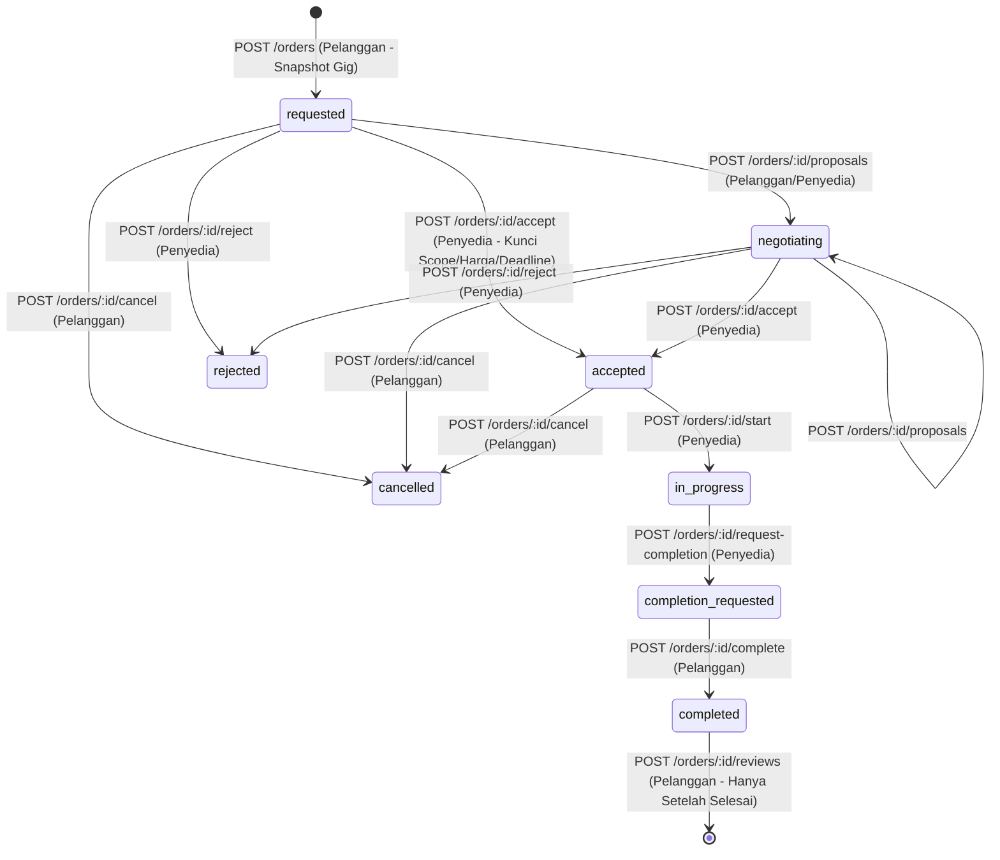
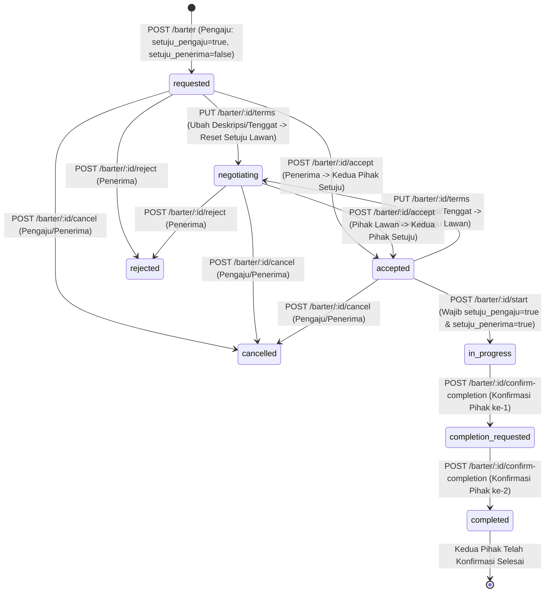

# Dokumentasi & Diagram Transisi Status: Order Lifecycle & Barter Lifecycle

Dokumen ini mendefinisikan aturan *state machine*, pemetaan enum final, hak akses aktor, serta penolakan transisi ilegal pada **Order Lifecycle API** dan **Barter Lifecycle API** SakuSkill.

---

## 1. Pemetaan Enum Status (`status_kode` & Label SKPL)

| `status_kode` (API Lifecycle) | Label SKPL (`status_pesanan` / `status`) | Kategori Status | Deskripsi |
| :--- | :--- | :--- | :--- |
| `requested` | `Diajukan` | Awal | Order atau penawaran barter baru dibuat oleh pelanggan/pengaju. |
| `negotiating` | `Dalam Negosiasi` | Aktif | Sedang dalam penyesuaian ruang lingkup (*scope*), harga, atau tenggat. |
| `accepted` | `Disepakati` | Aktif | Disetujui penyedia (Order) atau disetujui kedua pihak (Barter). |
| `in_progress` | `Dikerjakan` | Aktif | Pekerjaan sedang berlangsung. |
| `completion_requested` | `Menunggu Konfirmasi` | Aktif | Penyedia mengajukan klaim selesai (Order) atau baru 1 pihak konfirmasi selesai (Barter). |
| `completed` | `Selesai` | Terminal | Pelanggan mengonfirmasi selesai (Order) atau kedua pihak telah konfirmasi selesai (Barter). |
| `rejected` | `Ditolak` | Terminal | Ditolak oleh penyedia/penerima sebelum disepakati. |
| `cancelled` | `Dibatalkan` | Terminal | Dibatalkan sesuai aturan sebelum pekerjaan dimulai/diselesaikan. |

---

## 2. Diagram & Aturan Transisi Status Order (`/api/v1/orders`)

### Matriks Validasi Transisi Order
| Status Saat Ini | Target Status | Endpoint | Aktor yang Diizinkan | Transisi Ilegal yang Ditolak (`400` / `403`) |
| :--- | :--- | :--- | :--- | :--- |
| `requested` / `negotiating` | `accepted` | `POST /orders/:id/accept` | Penyedia Jasa | Ditolak jika dipanggil Pelanggan (`403`) atau dari status selain `requested`/`negotiating` (`400`). |
| `requested` / `negotiating` | `rejected` | `POST /orders/:id/reject` | Penyedia Jasa | Ditolak jika sudah `accepted`/`in_progress`/`completed` (`400`). |
| `requested` / `negotiating` / `accepted` | `cancelled` | `POST /orders/:id/cancel` | Pelanggan | Ditolak jika pekerjaan sudah `in_progress`, `completion_requested`, atau `completed` (`400`). |
| `accepted` | `in_progress` | `POST /orders/:id/start` | Penyedia Jasa | Ditolak jika belum `accepted` (`400`) atau dipanggil Pelanggan (`403`). |
| `in_progress` | `completion_requested` | `POST /orders/:id/request-completion` | Penyedia Jasa | Ditolak jika belum `in_progress` (`400`). |
| `completion_requested` | `completed` | `POST /orders/:id/complete` | Pelanggan | Ditolak jika Penyedia mencoba menyelesaikan sendiri (`403`) atau melompat dari `requested`/`in_progress` (`400`). |
| `completed` | Buat Review | `POST /orders/:id/reviews` | Pelanggan | Ditolak dengan `400 ORDER_NOT_COMPLETED` apabila status belum `completed`. |

---

## 3. Diagram & Aturan Transisi Status Barter (`/api/v1/barter`)

### Aturan Khusus Barter (Kerjaan #6 s.d. #10)
1. **Persetujuan Ganda Sebelum `in_progress` (Kerjaan #8):** Barter tidak dapat masuk ke `in_progress` sebelum `setuju_pengaju = true` dan `setuju_penerima = true` (status `accepted`).
2. **Konfirmasi Penyelesaian Dua Pihak (Kerjaan #9):** Saat pihak pertama memanggil `POST /api/v1/barter/:id/confirm-completion`, status berubah menjadi `completion_requested` (`Menunggu Konfirmasi`). Status baru berubah menjadi `completed` (`Selesai`) setelah pihak kedua juga memanggil endpoint konfirmasi penyelesaian.
3. **Proteksi Partisipan Transaksi (Kerjaan #10):** Pengguna di luar `pengaju_id` dan `penerima_id` otomatis ditolak dengan `403 FORBIDDEN_NOT_PARTICIPANT`.